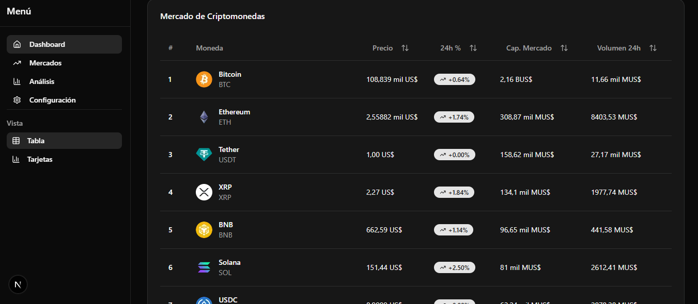

Cryptocurrency Dashboard

A modern cryptocurrency dashboard built with Next.js 15, featuring real-time market data visualization, responsive tables, and dark mode support. Fetches data from the CoinGecko API with manual refresh capabilities.

✨ Features
📊 Live Market Overview: Displays current prices, market caps, and 24h changes

🔄 Manual Data Refresh: Update cryptocurrency data with a single click

📈 Responsive Data Tables: Sortable and filterable tables with pagination

🌓 Dark/Light Mode: Toggle between themes with persistent preference

📱 Fully Responsive: Optimized for desktop, tablet, and mobile devices

🎨 Modern UI: Built with Shadcn UI components for consistent design

⚡ Fast Performance: Optimized with Next.js 15 and React Server Components

🛠️ Tech Stack
Frontend
Next.js 15.3.4 - React framework with App Router

React 19 - UI library with latest features

TypeScript - Type-safe development

Tailwind CSS v4 - Utility-first styling

Shadcn UI - Component library for consistent design

React Query/TanStack Query - Data fetching and caching (si usas)

Recharts - Charting library (si usas gráficos)

APIs
CoinGecko API - Cryptocurrency market data

Next.js API Routes - Server endpoints for API calls

Deployment
Vercel (recomendado) o Netlify

📂 Project Structure
text
crypto-dashboard/
├── app/
│ ├── layout.tsx # Root layout with providers
│ ├── page.tsx # Main dashboard page
│ ├── api/
│ │ └── crypto/
│ │ └── route.ts # API endpoint for CoinGecko calls
│ ├── components/
│ │ ├── dashboard/
│ │ │ ├── market-overview.tsx # Market summary cards
│ │ │ ├── crypto-table.tsx # Main data table
│ │ │ ├── refresh-button.tsx # Manual refresh component
│ │ │ └── search-filter.tsx # Search and filter controls
│ │ ├── ui/
│ │ │ ├── button.tsx # Shadcn button
│ │ │ ├── card.tsx # Shadcn card
│ │ │ ├── table.tsx # Shadcn table
│ │ │ └── theme-toggle.tsx # Dark/light mode switch
│ │ └── charts/
│ │ └── price-chart.tsx # Price visualization
├── lib/
│ ├── api/
│ │ └── coingecko.ts # CoinGecko API client
│ ├── utils/
│ │ ├── formatters.ts # Currency and number formatting
│ │ └── cache.ts # Data caching utilities
│ └── types/
│ └── crypto.ts # TypeScript interfaces
├── hooks/
│ ├── use-crypto-data.ts # Custom hook for crypto data
│ └── use-theme.ts # Theme management
└── public/
└── screenshot.png # Project screenshot
🚀 Getting Started
Prerequisites
Node.js 18.17 or later

npm, yarn, or pnpm package manager

CoinGecko API key (free tier available)

Installation
Clone the repository

bash
git clone <repository-url>
cd crypto-dashboard
Install dependencies

bash
npm install

# or

yarn install

# or

pnpm install
Environment Configuration
Create a .env.local file in the root directory:

env

# CoinGecko API (optional, but recommended for higher rate limits)

COINGECKO_API_KEY=your_api_key_here

# API Base URL (public API)

NEXT_PUBLIC_API_BASE=https://api.coingecko.com/api/v3
Note: You can use the public CoinGecko API without a key, but rate limits are stricter (30 calls/minute). Get a free API key at CoinGecko Developers

Run the development server

bash
npm run dev

# or

yarn dev

# or

pnpm dev
Open http://localhost:3000 in your browser.

Building for Production
bash
npm run build
npm start
📱 How to Use
Dashboard Features:
Market Overview

View top cryptocurrencies by market cap

See 24-hour price changes and trading volume

Data Table

Sort by any column (price, market cap, 24h change)

Search for specific cryptocurrencies

Filter by market cap or category

Manual Refresh

Click the "🔄 Refresh Data" button to fetch latest prices

Visual loading indicator during data fetch

Timestamp shows last update time

Theme Switching

Toggle between light/dark mode in the top right corner

Theme preference is saved in localStorage

🌐 Live Demo
👉 View Live Dashboard <!-- Añade tu enlace aquí -->

Performance Optimizations
Static Generation with Incremental Updates: Pages are pre-rendered and updated periodically

Client-side Data Refresh: Manual updates without full page reload

Efficient Caching: API responses cached to reduce unnecessary calls

Image Optimization: Next.js Image component for optimized assets

🔮 Future Enhancements
Planned Features
Real-time Updates: WebSocket integration for live price changes

Portfolio Tracker: Add and track personal cryptocurrency holdings

Advanced Charts: Interactive candlestick charts with historical data

Price Alerts: Set notifications for price thresholds

More Exchanges: Integrate with multiple exchange APIs

Mobile App: React Native version for iOS/Android

Technical Improvements
Redis Caching: Implement server-side caching for faster responses

API Rate Limit Handling: Smart queuing for API requests

Offline Support: Service workers for offline data access

Accessibility: Full WCAG 2.1 compliance

📊 API Rate Limits & Best Practices
CoinGecko Free Tier Limits:

30 calls/minute (without API key)

50 calls/minute (with free API key)

Consider implementing:

Request queuing

Response caching (1-2 minutes)

Exponential backoff for retries

🤝 Contributing
Contributions are welcome! Here's how you can help:

Fork the repository

Create a feature branch (git checkout -b feature/AmazingFeature)

Commit your changes (git commit -m 'Add some AmazingFeature')

Push to the branch (git push origin feature/AmazingFeature)

Open a Pull Request

📄 License
MIT License - feel free to use this project for learning, portfolio, or commercial purposes.

🙏 Acknowledgements
CoinGecko for their excellent free API

Next.js team for the amazing framework

Shadcn UI for beautiful components

Tailwind CSS for utility-first styling

Built with ❤️ by [Nelson Alejandro Cruz Borrego] - Junior Full-Stack Developer

Last updated: November 2025
